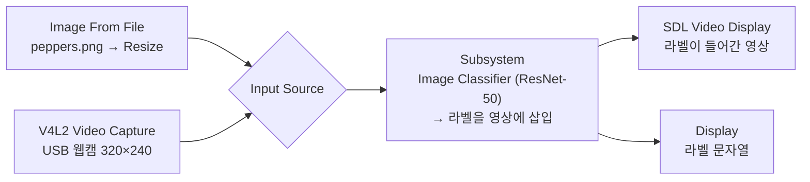

# 12. ResNet-50 이미지 분류 (Simulink)

11과 같은 분류를 Simulink의 Deep Learning 템플릿으로 구성한 실습입니다. 입력을 시뮬레이션용 이미지와 Pi 웹캠 중에서 스위치로 골라, 노트북에서 먼저 시뮬레이션하고 같은 모델을 Pi에 배포합니다.

| 파일 | 용도 |
|---|---|
| [`p63_resnet50_webcam.slx`](p63_resnet50_webcam.slx) | 분류 모델 |
| [`logs/p63_resnet50_webcam.log`](logs/p63_resnet50_webcam.log) | Pi에서 실행된 모델의 로그 |

- Image Classifier 블록은 `resnet50` 함수에서 네트워크를 불러옵니다. 예측 라벨은 문자열로 바뀌어 Insert Text 블록으로 영상에 써지고, 영상은 R, G, B로 나뉘어 화면 블록으로 갑니다.
- 시뮬레이션은 Simulation 탭의 Run, Pi 배포는 Hardware 탭의 Run on board → Build, Deploy & Start로 진행합니다.
- 로그의 `'Saturation' is not supported` 같은 문구는 웹캠이 해당 카메라 설정 항목을 지원하지 않는다는 안내입니다.
