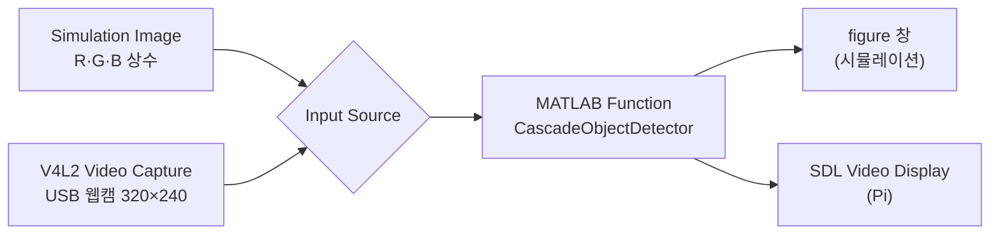

# 13. 정지 표지판 검출 (Cascade 검출기)

MATLAB에서 정지 표지판 검출기를 직접 학습하고, 그 결과를 Simulink 모델에 넣어 Pi 웹캠 영상에서 표지판을 찾은 실습입니다. 11·12의 분류가 이미지 전체에 라벨 하나를 붙인다면, 검출은 물체가 있는 위치를 박스로 알려 줍니다.

| 파일 | 용도 |
|---|---|
| [`p80_train_stop_sign_detector.m`](p80_train_stop_sign_detector.m) | 검출기 학습 스크립트. 학습 후 테스트 이미지로 검출 결과 확인 |
| [`stopSignDetector.xml`](stopSignDetector.xml) | 학습된 검출기 (OpenCV 호환 XML) |
| [`stop_sign_test.png`](stop_sign_test.png) | 동작 확인용 320×240 테스트 이미지 |
| [`p88_stop_sign_detector.slx`](p88_stop_sign_detector.slx) | 검출 모델. 시뮬레이션 이미지나 Pi 웹캠 영상에 검출 박스를 그려 표시 |
| [`logs/p88_stop_sign_detector.log`](logs/p88_stop_sign_detector.log) | Pi에서 실행된 모델의 로그 |

## 검출기 학습 (p80)

- 학습 데이터는 Computer Vision Toolbox에 들어 있는 예제입니다. 표지판 위치가 표시된 이미지(`stopSignsAndCars.mat`)를 정답으로, 표지판이 없는 이미지(`nonStopSigns`)를 배경으로 씁니다.
- `trainCascadeObjectDetector`로 HOG 특징을 쓰는 3단계 cascade를 학습합니다. Viola-Jones 방식처럼 간단한 판별기를 여러 단계로 이어 붙여, 앞 단계에서 표지판이 아닌 영역을 빠르게 걸러 내는 구조입니다.
- `stopSignDetector.xml`이 이미 있으면 다시 학습하지 않고 재사용합니다.
- 테스트 이미지는 예제 사진(`image029.jpg`)에서 표지판 주변을 잘라 웹캠 해상도(320×240)로 줄여 만들었습니다.

## Simulink 모델 (p88)

- MATLAB Function 블록은 검출기를 처음 한 번만 불러오고(`persistent`), 프레임마다 찾은 박스에 `stop sign` 라벨을 그립니다.
- 모델 안의 검출기 경로가 `/sdcard/stop_sign_detector/stopSignDetector.xml`로 지정되어 있어서, Pi에서 실행하려면 XML 파일을 이 위치에 복사해 둡니다.
